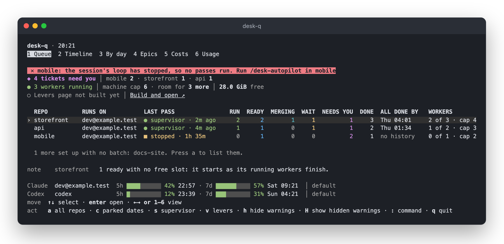
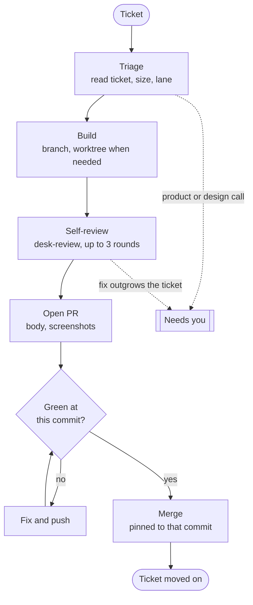
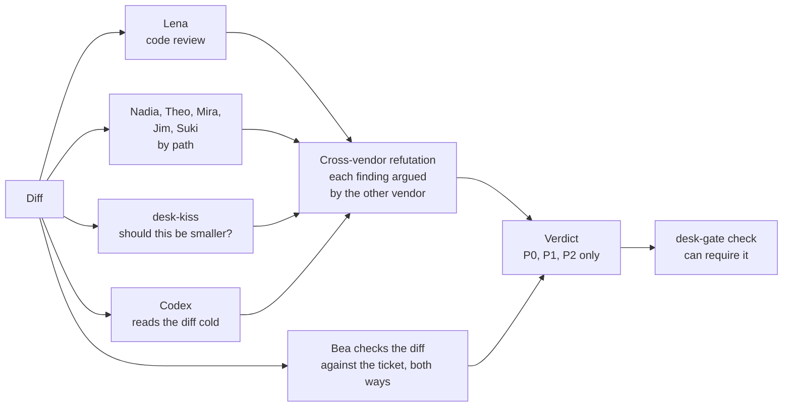
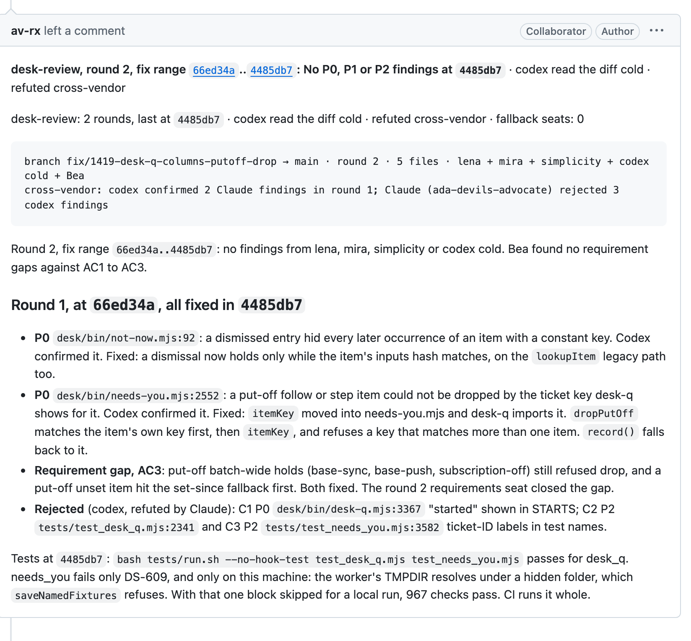
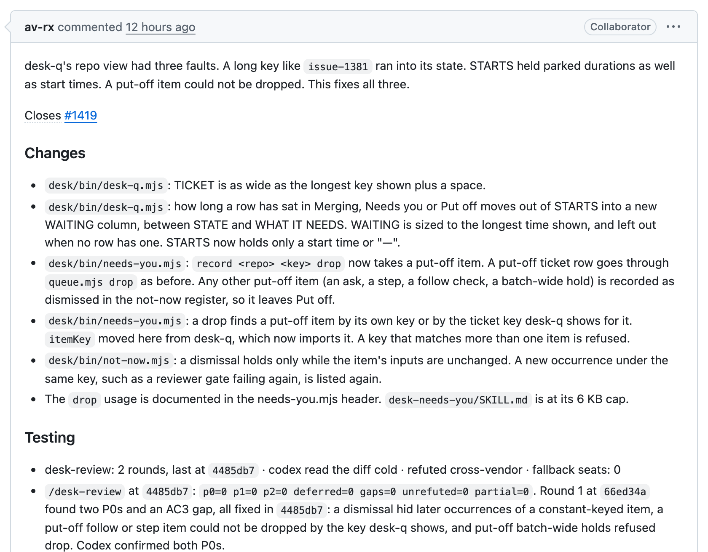
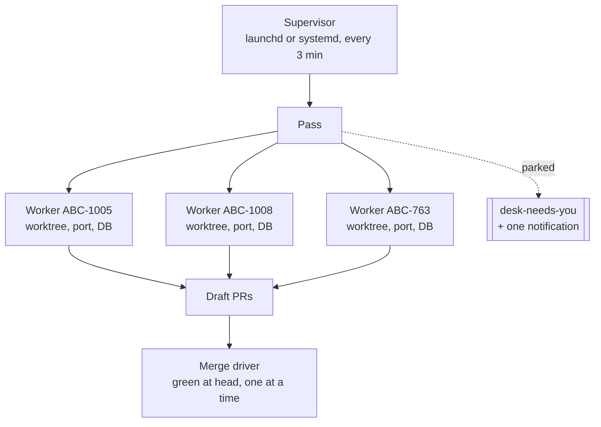
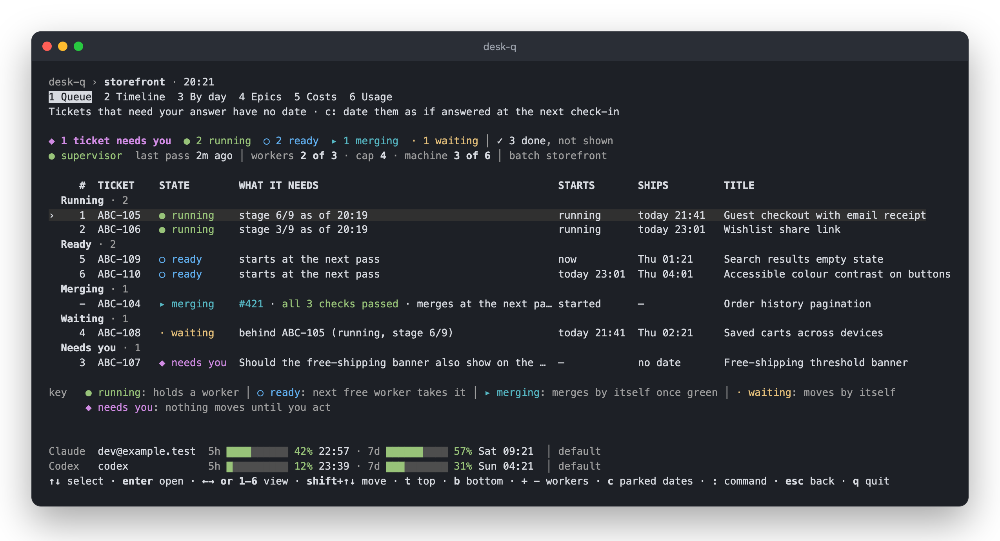
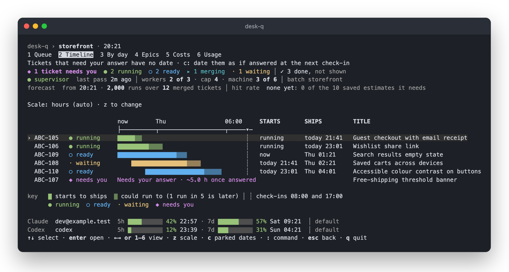
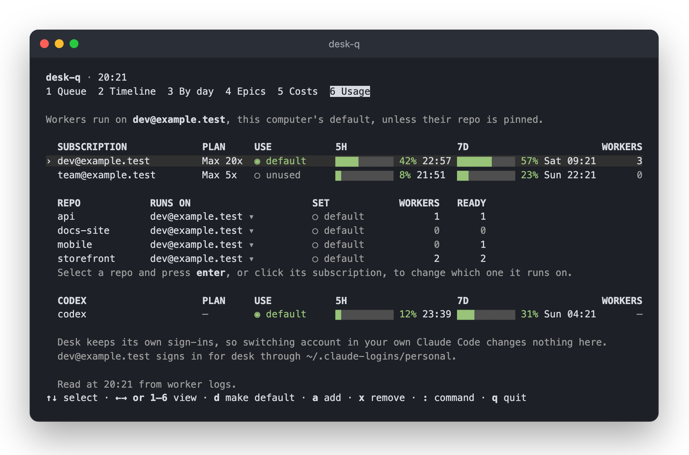

<div align="center">


# desk-skills

**From ticket to merged PR, on its own, inside the rules you set for each repo.**

Claude Code skills that triage a ticket, build it, review it and fix what the review finds,
open the PR with screenshots, and, where you allow it, merge it once it is green and move the
ticket on. Hand it one ticket
or a whole epic, then leave it to run.

[](https://github.com/bigbenjoman/desk-skills/actions/workflows/tests.yml)


[Quick start](#quick-start) ·
[How it works](#how-it-works) ·
[The skills](#the-skills) ·
[Autopilot](#autopilot-a-batch-while-you-do-something-else) ·
[Safety](#safe-by-default) ·
[Docs](docs/guide/README.md)



<sub>desk-q, the live view of every autopilot queue on the computer (demo data)</sub>

</div>

---

## Why desk

Coding agents can write a fix. Getting it **merged** is the slow part: a self-review, a PR body, CI,
review comments, a branch that fell behind, then the ticket left in the wrong column. desk does all of
it, the same way every time, and it stops to ask only when a person really has to decide.

- **Whole tickets, not just diffs.** One command reads the ticket and takes it all the way: triage,
  build, self-review, screenshots, PR, CI, merge, ticket transition.
- **Batches that run while you are away.** `/desk-autopilot` gives each ticket its own headless worker,
  worktree and port (and its own database where the repo has a local one), orders the batch so tickets
  don't collide, and, where you allow it, merges each PR once it is green. A supervisor can keep the
  batch going after you close Claude Code.
- **Reviews that try to prove themselves wrong.** `/desk-review` sends specialist finders over the diff,
  Claude's and Codex's, has the other vendor try to refute each finding, and checks the change against
  its ticket in both directions. Only P0 to P2 findings make the report.
- **Each repo has its own rules.** Every repo has its own tracker, people, commands, required checks,
  conventions and permissions. Nothing set for one repo leaks into another, and desk's config for
  each repo lives outside the repo, never in git.
- **Permissions you answer once.** Every capability (push, open a PR, merge, comment on Jira, read
  Slack…) is `yes`, `ask` or `no`, per repo. Anything at `ask` is asked each time; `no` is never done.
- **"Green" means green.** Every required check passed on the exact commit, nothing else failed, and
  the merge is pinned to that commit. A skipped check doesn't count.
- **One place to answer.** Anything that needs you, from every repo, lands in `/desk-needs-you`: four
  questions at a time, each with a recommendation.
- **You can see everything.** `desk-q` shows every queue on the computer: what's running, what's
  parked, when each ticket should ship, and what it is costing.

## Quick start

You need [Claude Code](https://claude.com/claude-code), `git`, `gh`, `node`, `python3`, `jq` and
`curl`. [Codex](https://github.com/openai/codex) is optional but recommended, for cross-vendor review.

```bash
gh repo clone bigbenjoman/desk-skills ~/desk-skills
cd ~/desk-skills && ./install.sh     # once per computer; asks before it touches your settings
```

1. **Restart Claude Code** so it loads the skills, agents and hooks.
2. **`cd` into a repo and run `/desk-setup`.** It works out what it can from the repo and GitHub, you
   confirm it, then it asks each permission for that repo, one question at a time. Allow 15 to 20
   minutes the first time.
3. **Do step 2 in each repo you want desk in.** From the second repo on, setup can start from an
   earlier repo's answers, and you confirm each one.
4. **Before a repo's first autopilot batch**, run the [preflight](docs/guide/autopilot.md#the-preflight)
   once. It proves the worker sandbox on your computer.

Then:

```text
/desk-ticket ABC-123                    one ticket, from triage to merged PR
/desk-autopilot ABC-1 ABC-2 ABC-3       a batch, one worker per ticket
/desk-autopilot ABC-900                 an epic: its open children, on its own feature branch
/desk-needs-you                         answer everything waiting on you, in every repo
```

No Jira? A "ticket" can also be a GitHub issue (`#42` or its URL), a work id you list in setup, or a
plain sentence: `/desk-ticket "the export button is greyed out for admins"`.

## How it works

`/desk-ticket` runs the same pipeline on every ticket. It sends the work down the cheapest route that
can solve it, and always finishes with the same tail.



Anything with consequences, such as a product or design call or a fix that grows beyond the
ticket, stops and asks instead of guessing. Merging happens only where you allowed it in that repo.
The recommended setup leaves merging to you, and reports PRs that are ready instead.

### Reviews that argue with themselves



Specialist finders run read-only, routed by the paths the diff touches, while Codex reads the diff
cold and Bea checks it against the ticket. A finding has to survive a refutation from the other
vendor (Codex for Claude's findings, Claude for Codex's) before it is reported. Where the repo allows it, the verdict is
posted as one `COMMENTED` review with a machine-readable line that a required check
(`desk-gate.yml`) can read. desk-review never approves or blocks a PR itself.

<details>
<summary><b>See a real desk-review verdict and desk-pr body</b> (from <a href="https://github.com/bigbenjoman/desk-skills/pull/1433">PR #1433</a> in this repo)</summary>
<br>





</details>

## Autopilot: a batch while you do something else

```text
/desk-autopilot ABC-1005 ABC-1008 ABC-763
```

| Stage | What happens |
|---|---|
| 1. **Triage** | Reads each ticket, read-only, and flags anything it can't do on its own. |
| 2. **Plan** | Orders the batch so tickets that touch the same files don't collide. |
| 3. **Ask once** | Every open question for the whole batch, in one go. Then you can walk away. |
| 4. **Run** | One headless worker per ticket, each in its own worktree and port, with only the permissions you granted in this repo. Each gets its own database where the repo has a local one. Otherwise its database variables are blanked, so no worker can reach a shared or production database. |
| 5. **Merge** | Where you allowed it, each PR merges one at a time with the repo's merge method, once it is green at its head. PRs into the default branch that touch a merge-hold path are left for you, unless the hold names a routine you've let desk run. |
| 6. **Park** | Anything that needs a person waits, and you get one desktop notification. |



- **Epics run as feature batches.** `/desk-autopilot ABC-900` runs the epic's open children on its own
  feature branch, alongside the standing batch. Jira "is blocked by" links are honoured, L and XL
  tickets are parked to be split, and the epic's own criteria are checked when the last child merges.
  [Bea](#subagents) writes epics in this shape ("Hello Bea, this is an epic").
- **No session needed.** Where a repo's batches are run by the supervisor (setup's default on macOS,
  and available on Linux with systemd), it runs from launchd or a systemd user timer, so workers keep
  going after you close Claude Code. On Linux, turn on lingering to keep it going after logout; on
  WSL, keep a terminal open.
- **Several repos at once.** Batch state is kept per repo, so two repos can run batches side by side.
- **Come back any time.** Run `/desk-autopilot` again, or ask "how's the batch going?", to check
  progress, answer a parked question or resume.

Full detail: [docs/guide/autopilot.md](docs/guide/autopilot.md).

## See every queue: `desk-q`



<details>
<summary><b>More desk-q screens</b>: Timeline and Usage</summary>
<br>





</details>

`desk-q` is a full-screen terminal view of every autopilot queue on the computer. It reads the queues
straight from their files and changes nothing unless you ask it to (reorder a ticket, change the worker
count, switch a supervisor), so it is fast and safe to leave open.

| Tab | Shows |
|---|---|
| **Queue** | Each repo's unfinished tickets, grouped by state, in spawn order |
| **Timeline** | A bar per ticket from when it starts to when it should ship, with a bar per epic first |
| **By day** | Tickets grouped by the day they are forecast to ship |
| **Epics** | Each epic and the state of its children |
| **Costs** | This month's charges per repo and supplier (GitHub, Vercel, AWS…) |
| **Usage** | Every Claude and Codex login on the computer, its plan and how much is used |

```bash
desk-q                          # every batch; arrow keys, Enter, Esc, 1-6 for tabs
desk-q storefront               # one repo, by any unique prefix of its name
desk-q storefront top ABC-763   # move a ticket to the front of the spawn order
desk-q storefront workers 4     # change the batch's worker count
desk-q --plain                  # plain text, for pipes
desk-q --json home              # the same figures as JSON, for scripts
```

## The skills

**21 skills.** You start the ones with a command. The ones marked *auto* load themselves when you
say what you want ("open the PR", "move it to review", "reply to the review"). Every one reads this
repo's config first and does only what its permissions allow.

### Do the work

| Skill | What it does | Start it with |
|---|---|---|
| `desk-ticket` | One ticket, from triage to merged PR. It can also do one step on its own: "just push it", "give me the PR body". | `/desk-ticket ABC-123` |
| `desk-autopilot` | A batch of tickets, or an epic's children, with one detached worker each, merged as each goes green. | `/desk-autopilot ABC-1 ABC-2` |
| `desk-admit` | Adds tickets to a running batch after the intake checks (fresh triage, lane, lint, open questions, size, blockers), and says why when it turns one away. | `/desk-admit ABC-7 --front` |
| `desk-design` | Saves a ticket's Claude Design canvas into the repo, renders every board at each breakpoint, and compares the built UI with it. | `/desk-design ABC-123` |
| `desk-pr` | Opens or updates the PR: diff hygiene, the body in this repo's sections, before and after screenshots, stacked PRs. | *auto* |
| `desk-jira` | Every tracker write (create, edit, comment, link, transition), each gated by its own permission. | *auto* |
| `desk-dev` | Runs the app locally, and against a copy of staging data where the work needs real records. | *auto* |

### Review

| Skill | What it does | Start it with |
|---|---|---|
| `desk-review` | Reviews a branch, a PR or every open PR at this repo's bar, with read-only finders, Codex refutation and a ticket check both ways. | `/desk-review`, `/desk-review 460` |
| `desk-kiss` | Should this change be smaller? Finds scope creep, abstractions with one consumer and comments that narrate, then offers each fix. | `/desk-kiss 460` |
| `desk-review-response` | Works a reviewer's comments: assess, agree, fix, self-review, reply in the repo's register, resolve. | *auto* |

### Keep things moving

| Skill | What it does | Start it with |
|---|---|---|
| `desk-needs-you` | Everything waiting on you, in every repo, four at a time with a recommendation each. | `/desk-needs-you` |
| `desk-clearance` | Takes your reviewed PRs the rest of the way: comments, threads, branch updates, CI, merge, ticket. | `/desk-clearance` |
| `desk-groom` | Checks every open ticket and epic for duplicates, work already merged, stale links and blank fields, and proposes each fix with evidence. It writes nothing. | `/desk-groom` |
| `desk-cleanup` | Merged worktrees, stale branches, ticket statuses that drifted from GitHub, leaked dev servers. | `/desk-cleanup` |
| `desk-checkout` | Drafts your end-of-day update from calendar, meeting notes, Jira, GitHub, Slack and your sessions. It never sends. | `/desk-checkout` |

### This computer and this repo

| Skill | What it does | Start it with |
|---|---|---|
| `desk-setup` | Detects the repo's tracker, checks, toolchain and conventions, asks what desk may do here, and writes the config. | `/desk-setup` |
| `desk-update` | Brings every skill and plugin up to date, brew-style, showing the diff before each upgrade. | `/desk-update` |
| `desk-ci` | Decides which CI jobs can safely run self-hosted, lints workflows so no self-hosted job gets a secret, measures CI cost and red rate, and hardens branch protection. | `/desk-ci measure` |
| `desk-resume` | Carries on from a context handoff after `/clear`. | `/desk-resume` |
| `desk-reboot` | Gets the computer ready to restart: busy sessions save a handoff, and unsaved worktrees are listed. It never reboots. | `/desk-reboot` |
| `desk-disk` | When the disk runs low: measures each known offender, explains it, and frees space one approved fix at a time. | `/desk-disk` |

Every command form, flag and permission: [docs/guide/skills.md](docs/guide/skills.md).

### Subagents

Eleven named specialists, available in every repo. Each one reads the repo's config, `CLAUDE.md` and
stack before it starts, and none assumes a framework. Call one by first name: "Hello Bea", "ask
Nadia".

| | | |
|---|---|---|
| **Ada**, devil's advocate | **Bea**, business analyst (writes tickets and epics) | **Jim**, solution architect |
| **Karen**, SEO, GEO and AEO | **Lena**, code reviewer | **Mira**, Playwright and E2E |
| **Muriel**, design to code | **Nadia**, security auditor | **Otto**, IA mapper (`/userflow`) |
| **Suki**, frontend architect | **Theo**, API designer | |

### Batteries included

`install.sh` also installs **59 third-party skills**, listed with their sources and pins in
[`vendor/sources.json`](vendor/sources.json), covering UX and UI, React and Next.js, APIs and
databases, auth and payments, security, infrastructure, testing and SEO. It also offers the
`superpowers`, `code-review`, `code-simplifier`, `frontend-design`, `vercel` and `codex` plugins.
`/desk-setup plugins` switches off, per repo, the ones that repo doesn't need. Every skill on the
computer has [one real copy](docs/guide/install.md#skills-one-copy-each), so there is nothing to drift.

## Safe by default

desk is built to be left alone with a repo. These are the rails:

| Rail | What it means |
|---|---|
| **Per-repo permissions** | Every configurable capability is `yes`, `ask` or `no`, answered by you in `/desk-setup`. Anything unanswered is `no`. Allow rules go only in that repo's git-ignored `.claude/settings.local.json`. |
| **Sandboxed workers** | Autopilot workers start without your own Claude Code settings, so a broad allow rule of yours never reaches them. A worker can push only its own branch, and cannot merge, undraft, run `git config` or aliases, use `gh api`, or write outside its worktree. The preflight checks the worktree and git boundaries on your computer. |
| **No shared databases** | A worker gets its own local database, or has its database variables blanked. |
| **Merge holds** | Paths you name, such as infra or migrations, are left for a person to merge, unless the hold names a routine you've let desk run. |
| **Config outside your repo** | Config lives in `~/.config/desk/repos/<owner>__<name>/`, never in git. The only settings file desk writes in a repo is `.claude/settings.local.json`, and only when git ignores it. |
| **Secrets stay out of chat** | You write the Jira token to a file yourself. Setup never asks you to paste it. |
| **AI attribution rules** | A repo can forbid AI co-author trailers, and a hook enforces it there. |
| **Context handoffs** | Past a set context size, a session writes a handoff, and after `/clear` or a compaction it carries on from it. |
| **Rollbacks** | Each install is its own release. A release watch compares each auto-released version with the one before, and pins back and opens revert PRs if it does worse. `./install.sh --rollback` does it by hand. |

## Built with itself

desk-skills is developed by its own autopilot. Since 27 September 2026 the repo has merged **over
1,100 pull requests**, nearly all of them from ticket branches worked through desk itself, reviewed
by `desk-review` and merged once green. **292 test suites** run in throwaway homes and repos, sharded across
Linux CI and checked under macOS's bash 3.2.

## Requirements

| Tool | Notes |
|---|---|
| Claude Code, `git`, `curl`, `jq`, `node`, `python3` | Required |
| `gh` | `gh auth login -s repo,workflow` |
| `codex` | Optional, for cross-vendor review: `brew install --cask codex` or `npm i -g @openai/codex`, then `codex login` |
| `mise` | Only for repos that pin tools through it |
| `lsof`, `flock` | `lsof` comes with macOS (`apt install lsof` on Linux). `flock` is optional |

`./install.sh --check` names anything missing and changes nothing. macOS, Linux and WSL are supported.

## Updating

```bash
cd ~/desk-skills && git switch main && git pull --ff-only && ./install.sh
```

Then restart Claude Code. Or run `/desk-update` from anywhere. Once a day, your first session says when there is something new.
Repo configs are kept. If the template gained rows, `/desk-setup` asks only those.

## Troubleshooting

| Symptom | Cause and fix |
|---|---|
| A skill says there is no config for this repo | Run `/desk-setup` here. `desk-env where` shows the slug it looked up; a clone with no GitHub `origin` gets a `local__…` slug of its own |
| A skill stops on a `TODO` | That row was never answered; re-run `/desk-setup` in the repo |
| `desk-jira` says authentication failed | The token in the repo's folder is wrong or expired; rewrite `atlassian-token` (see [Jira login](docs/guide/configuration.md#jira-login-per-repo)) |
| The autopilot preflight fails `ESCAPE` | The worker was not isolated from your own settings: reinstall (`./install.sh`) and re-run the preflight |
| Claude Code keeps asking before commands | Expected for anything you did not grant as `yes`; grant it per repo with `/desk-setup permissions` |
| A green PR is never merged by autopilot | It touches a §4 Merge holds path, has outstanding review feedback, has no clean §4 Local review verdict at its head, needs an approving review GitHub requires, or `pr-merge-green`/`autopilot-merge` is not `yes` and merging was not approved for the batch at Stage 3 |

## Documentation

| | |
|---|---|
| [Skills reference](docs/guide/skills.md) | Every skill, command form and permission, plus subagents and third-party skills |
| [Autopilot](docs/guide/autopilot.md) | Batches, the worker sandbox, the preflight, the supervisor |
| [Configuring a repo](docs/guide/configuration.md) | `/desk-setup`, the config file, Jira logins, changing things |
| [Install and update](docs/guide/install.md) | What `install.sh` does, hooks, updating, the skill index |
| [Skill evals and benchmarks](docs/guide/benchmarks.md) | Proving a skill earns its place, and comparing models on real tickets |
| [Developing desk-skills](docs/guide/development.md) | Tests, CI, and how the pass is built |

desk-skills began as studia-skills 2.3, with every company-specific fact moved into the per-repo
config. [`docs/porting-contract.md`](docs/porting-contract.md) records each mapping.
